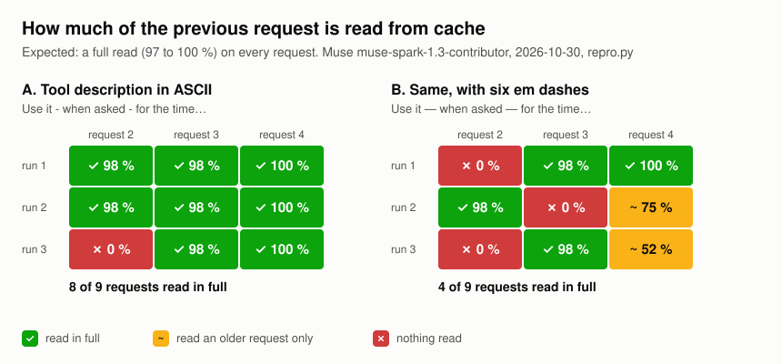

# Muse: prompt cache missed when the request contains a few non-ASCII characters

Model `muse-spark-1.3-contributor`, endpoint `https://api.meta.ai/v1/messages`, tested on 2026-10-30.



## Expected

A conversation is sent as growing requests: each request repeats the previous one and adds a
message (`[ok]` is the assistant's short reply). Each request should read the previous one from
cache.

```
request 1:  [tool] [system] [question 1]
request 2:  [tool] [system] [question 1] [ok] [question 2]                     <- reads request 1 from cache
request 3:  [tool] [system] [question 1] [ok] [question 2] [ok] [question 3]   <- reads request 2 from cache
```

A full read shows as 97 to 100 %: the last few tokens of a request are never cached.

## Actual

Caching works when the tool description is plain ASCII: **8 of 9** requests read in full. With the
same description containing six em dashes (`—`, U+2014), most requests are not cached: **4 of 9**.
Only the tool description differs:

```diff
- "description": "Returns the current time. Use it - when asked - for the time. Notes - a - b - c - d."
+ "description": "Returns the current time. Use it — when asked — for the time. Notes — a — b — c — d."
```

(The system prompt also carries a random tag, so that each conversation starts with an empty cache.)

When a request with em dashes misses, it often reads an *older* request in full: for example
request 4 reads exactly the tokens of request 2 (75 %) or of request 1 (52 %). The cache entry
exists, but the newest one is not found.

The position matters: the same six em dashes break caching at character 100 of the system prompt,
not at character 5 000. The problem seems tied to the first part of the request. More tests:
[`DETAILS.md`](DETAILS.md).

**Impact:** Claude Code (Anthropic's coding agent) has em dashes in its tool descriptions, near
the start of every request. Claude Code sessions on Muse pay full price for most requests.

## How to reproduce

```
API_KEY=<Muse key> python3 repro.py
```

Python 3 only, no dependency, about one cent, one minute. [`repro.py`](repro.py) sends case A and
case B three times each and prints the share read from cache, with each `x-request-id`. Our output
([`runs/minimal`](runs/minimal/), 2026-10-30, 09:23 UTC), the figure above:

```
run 1  A (ASCII)           98% (a1920f60-f16f-431f-9c5b-50a7ef1a597d)   98% (8ae7398c-3590-4508-a88b-c81213af9787)  100% (730b2695-6f87-4fa6-ba10-9b33332eec01)
run 1  B (six em dashes)    0% (fe3c4891-0905-4d04-aa9a-38d83a3ed9aa)   98% (eab47b77-1229-44ff-8035-6af6389e45b1)  100% (76a7ae42-5342-4795-b8b7-c6179f2a7fe8)
run 2  A (ASCII)           98% (da4b175e-0fc9-4c7f-ac70-ef2e71b52e1c)   98% (1163dc1f-9011-450e-b6c5-94e0183170c1)  100% (72456a74-3e2d-425b-aa1d-b61c34fadf66)
run 2  B (six em dashes)   98% (140b7b6e-dad9-47ef-9a92-3d7e6c29a79d)    0% (478c4b35-f79a-4db0-9742-9d2de420c687)   75% (62d33094-cdc8-46b2-aef9-e6ee61886d6e)
run 3  A (ASCII)            0% (0d49e109-2ba9-48ec-b759-d46b2d559f50)   98% (3c0631d1-46b6-4ecc-9879-651c27a372f7)  100% (ce0e6295-d18b-43bb-828e-ffd0a838208c)
run 3  B (six em dashes)    0% (556b10ae-b25d-4b81-9b26-6e370e580a08)   98% (c08be789-e419-4d1d-a865-31186c552fa6)   52% (2bf0d72d-488e-4edb-a821-2cf7e1086bd1)
```
